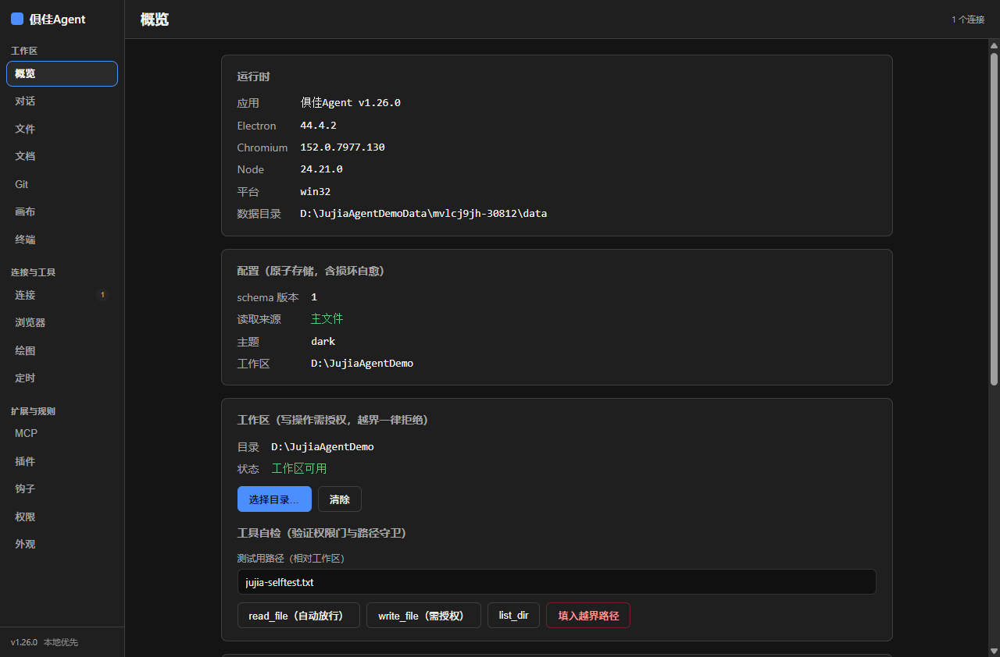
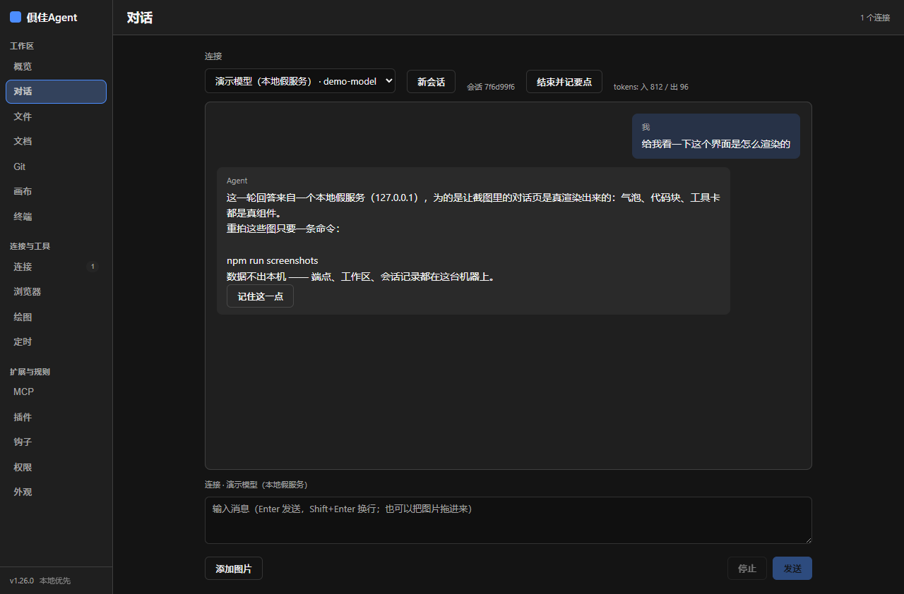
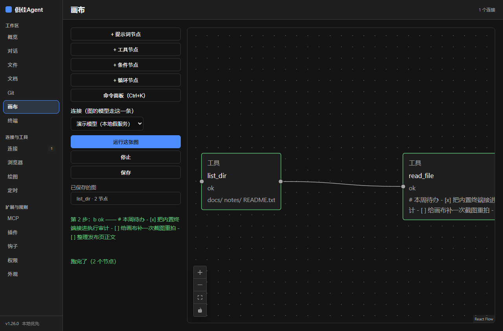
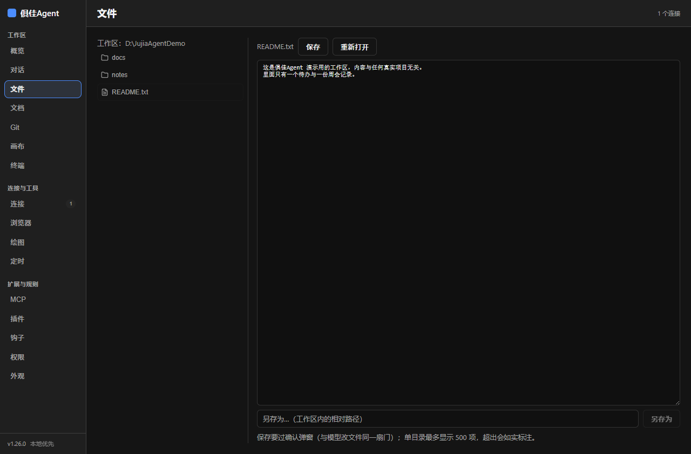

# 俱佳Agent

一个**跑在你自己 Windows 上**的个人 Agent：能读文件、改代码；命令执行走**你自己驱动的内置终端**
或**你逐个批准的 MCP 工具**（模型的 `run_command` 同样**每一条都要你确认** —— 执行类是硬 ask，"总是允许"压不掉），
而且**每个有副作用的动作都要你点头**。**默认不出本机；只有你显式接入自己的主机、并显式把任务迁过去时，数据才会去到那台主机。本产品没有服务器。**
你自己发起的模型请求（文字 / 图片）只发给**当前连接**的服务商，**图片附件**本机从不保留副本；
其余出网逐条见 [`SECURITY.md`](SECURITY.md) 的出站表。

- **形态**：TypeScript + Electron（本地优先，单机运行，无需服务端）
- **许可**：MIT（见 [`LICENSE`](LICENSE)）
- **支持平台**：**Windows 10/11**（打包产物为 Windows 安装包）。源码层面对 macOS / Linux
  做了兼容处理，但**尚未在这些平台上验证**，欢迎你来补验证。

> **⚠️ 先读安全说明**：这个项目**会执行命令、会改你的文件**，它**不是安全沙箱**。
> 使用前请务必看 [`SECURITY.md`](SECURITY.md)（能做什么/没做什么、如何报告漏洞、使用建议）。

## 界面一览

截图取自 **`v1.26.0` 的打包产物**（不是设计稿，也不是开发态 —— 开发态的版本号会回落到 Electron 版本）。
数据目录与工作区都是**中性演示路径**（`D:\JujiaAgentDemo*`），拍完自动清场。
**重拍一条命令**：`npm run screenshots`（离屏渲染，不弹窗口；产物与版本、提交、是否干净都记在
[`docs/screenshots/manifest.json`](docs/screenshots/manifest.json) 里）：

| 概览 | 对话 |
|------|------|
|  |  |
| **画布** | **文件** |
|  |  |

- **概览页**：运行时与配置（含损坏自愈的可见面）· 安全基线 · **运行日志**（文件在哪 / 今日条数 /
  级别过滤 —— 日志只在点按钮时读，从不出网）· **更新**（查一次说一句，不自动下载不自动安装）；
- **对话页**：一条真的流式回答（端点是本地假服务）；执行类动作全部走审批弹窗；
  要点需手动「记住这一点」才会写进长期记忆；
- **画布页**：两个工具节点跑完之后的样子 —— 节点状态由主进程事件回写，输出是真从磁盘读的
  （`list_dir` 的目录列表、`read_file` 的正文），不是画上去的；
- **文件页**：工作区树 + 打开的文本文件（保存要过确认弹窗，与模型改文件同一扇门）。

## 核心理念与独特之处

这个项目的设计出发点不是"再加一个能聊天的编程助手"，而是**把"不信任"做成产品的一部分**：
模型可以提议，但**放行与否由确定性的代码和你的手指决定**。以下几条是它区别于同类工具的地方 ——
每一条都有对应的实现与可复跑的验证，不是宣传话术。

**1. 权限判定是确定性规则，不交给模型。**
判定入口是一个纯函数（`decideGate`），输入只有模式、工具、参数与你的规则表，输出放行/询问/拒绝；
模型无法通过"说服"改变它。5 种权限模式 + 自定义规则表（`allow`/`deny`/`ask` + 工具名 glob，
其中 `deny`/`ask` 还能窄到**命令行的字面前缀**，`allow` 那一侧在校验层直接拒），
其中 **`deny` 与 `ask` 绝对生效**（连"全部放行"模式也让路）。模型自称"已获授权"不是授权。

**2. 接入外部能力要逐项点头，没点头的工具连调用路径都不存在。**
MCP 服务端连接后先展示**将执行的完整命令**与风险，工具清单**默认一个都不勾选**；
未批准的工具**不会注册进工具表** —— 不是"注册了但拦着"，而是根本调用不到。

**3. "拒绝"是真的拒绝。**
拒绝接入会**退掉那个进程**（不留后台常驻）；被拒的工具调用**远端一次都不会被调用** ——
这条有自动化断言作证：让服务端在每次 `tools/call` 时往 stderr 写一行，主进程据此精确断言"零调用"。

**4. 默认不出本机；只有你显式接入自己的主机、并显式把任务迁过去时，数据才会去到那台主机。本产品没有服务器。**
默认这一条**不是可选项**（唯一的例外就是上面那一个）：密钥不进渲染层、不进模型上下文、**也不进钩子输入**；
MCP 的环境变量**值**不回传界面（只回传键名）；有副作用的动作一律先问。所有数据落在本机一个数据根目录里。
出网的地方**逐条列在 [`SECURITY.md`](SECURITY.md) 的出站表里**（什么时候发、送出什么都写着）：
① **模型请求**（文字 / 图片 / 绘图生成）——发给**当前连接**的服务商，图片以内容块发给它，本机不保留副本
（历史里只有一句「图片未保留 ×N」）；② **更新检查**——你点一下，发一条**不带任何本机数据**的 GET
取公开发布信息（不下载、不执行、不会自动轮询）；③ **内置浏览器**——你访问网页时与那个站点之间的正常流量；
④ **你自己连接并批准的 MCP 服务端**——工具参数交给它，而它是个**独立程序**，它自己往哪儿发不受我们控制。
除此之外没有别的出口。

**5. 把"可验证"当产品特性，而不是开发者的自觉。**
- 每阶段做**变异测试**（故意改坏实现，看测试红不红）—— 累计例数与逐轮明细见
  [`docs/PROGRESS.md`](docs/PROGRESS.md) 与 [`review/REVIEW-LOG.md`](review/REVIEW-LOG.md)（**数字只写一处**，避免漂移），
  并且真的抓到过多次"测试看着绿、其实什么都没锁住"的漏洞（逐次见复核台账）；
- 端到端用**真子进程**（真 spawn、真超时、真杀进程树），不靠假实现推断结论；
- 有一条**无头 dev 管线探针**，专门防"构建全绿但开发模式黑屏"这类只在一种模式下暴露的问题；
- 复核台账（`review/REVIEW-LOG.md`）**公开在仓库里**，包括未通过项与原因。

**6. 边界如实标注。**
未验证的平台、未接入的事件、已知欠账，都写在 `docs/PROGRESS.md` 与 `review/` 里 ——
而不是留一句"理论上支持"。宁可交付"做到这里 + 明确说明"，也不交付"看起来全做了"。

### 文档导航

| 想了解 | 看哪里 |
|--------|--------|
| 怎么用、怎么装 | 本文件「快速开始」 |
| **第一次接手（人或 AI）：唯一的交接基准 —— 项目是什么、做到哪、下一步做什么、怎么推 GitHub、用什么凭证、避哪些坑** | [俱佳Agent交接文档.md](俱佳Agent交接文档.md) |
| 技能怎么写（按需查阅的说明书） | [docs/SKILLS.md](docs/SKILLS.md) |
| 长任务与断点续跑怎么设计（M17 批一） | [docs/DESIGN-M17.md](docs/DESIGN-M17.md) |
| 钩子怎么写（可拒绝的自动化） | [docs/HOOKS.md](docs/HOOKS.md) |
| 插件怎么打包（整包分发） | [docs/PLUGINS.md](docs/PLUGINS.md) |
| 测试临时文件落在哪（不占系统盘） | [docs/TEST-POLICY.md](docs/TEST-POLICY.md) |
| 安全边界与风险声明 | [SECURITY.md](SECURITY.md) |
| 做了什么、还差什么 | [docs/PROGRESS.md](docs/PROGRESS.md) · [CHANGELOG.md](CHANGELOG.md) |
| **总览清单**（已完成 ✅ / 待做 ⏳，一张总表） | [docs/CHECKLIST.md](docs/CHECKLIST.md) |
| 每轮复核记录（含未通过项） | [review/REVIEW-LOG.md](review/REVIEW-LOG.md) |
| 工作怎么分类与记录（轨道计划） | [docs/TRACK-PLANS.md](docs/TRACK-PLANS.md) |
| **设计基调**（颜色/字级/间距/动效令牌与展开-收起规则；前端打磨的判据） | [docs/DESIGN-BASELINE.md](docs/DESIGN-BASELINE.md) |
| 开发必须遵守的工作协议（32 条，逐条有出处） | [docs/WORK-PROTOCOL.md](docs/WORK-PROTOCOL.md) |
| 会话持久化的数据布局**报备稿**（五开关已批，6a 已交付 `v0.38.0-铺设6a`） | [docs/DESIGN-SESSIONS.md](docs/DESIGN-SESSIONS.md) |
| 会话压缩与自动摘要**报备稿**（七条已批，已交付 `v0.44.0-铺设6b`） | [docs/DESIGN-COMPACT.md](docs/DESIGN-COMPACT.md) |
| 切走页签不丢对话连接的**报备稿**（七条已批，已交付 `v0.45.0-T22`） | [docs/DESIGN-T22-TAB-STATE.md](docs/DESIGN-T22-TAB-STATE.md) |
| 轻量 IDE 的**报备稿**（八条已批，M19a/M19b/M19c 均已交付） | [docs/DESIGN-M19-IDE.md](docs/DESIGN-M19-IDE.md) |
| 无限画布（M9）的**报备稿**（九条已批，**M9a 已交付 `v0.50.0-M9a`**） | [docs/DESIGN-M9-CANVAS.md](docs/DESIGN-M9-CANVAS.md) |
| 无限画布**第二批**的**报备稿**（B1 对齐/命令面板 + B2 局部重跑，已获预批） | [docs/DESIGN-M9b-CANVAS-B.md](docs/DESIGN-M9b-CANVAS-B.md) |
| **多模态输入（M11 批一）的报备稿**（四条批复已落：新表述 / 附件不落盘 / 上限 / EXIF 剥离） | [docs/DESIGN-MULTIMODAL.md](docs/DESIGN-MULTIMODAL.md) |
| 画布 ↔ 编码引擎的**接驳契约**（节点如何调工具；M9a 交付物，R16 细化了子代理接线口） | [docs/LINKAGE-M9.md](docs/LINKAGE-M9.md) |
| **M14 边界备忘**（多子 agent 编排的归口候选口径 + 画布接线口；R16 文书，**未实现、不宣称**） | [docs/DESIGN-M14.md](docs/DESIGN-M14.md) |
| **流的结束口径**（T55/T56：凭什么判"说完了"、判不出时该说什么；R31 定稿） | [docs/DESIGN-T55-STREAM-END.md](docs/DESIGN-T55-STREAM-END.md) |
| **探活与自动重连的口径**（T31：掉线凭什么判、要不要自动重连、重连后正在跑的回合怎么办、用户在哪看得见；R37 定稿，**只有文书、没有实现**） | [docs/DESIGN-T31-PROBE-RECONNECT.md](docs/DESIGN-T31-PROBE-RECONNECT.md) |
| **大文件拆分的评估稿**（R38：**只评估不拆**；行数一律按 eslint 口径 —— max 800 · skipBlankLines: true · skipComments: true；含 T57③ 的结论） | [docs/DESIGN-R38-BIGFILE-EVAL.md](docs/DESIGN-R38-BIGFILE-EVAL.md) |
| **设计与动效的基线**（R41 起：**我们自己的设计口径** —— 令牌怎么用、动效的铁律、焦点环与命中区的下限；学到的做法**内化成"我们为什么这样做"**） | [docs/DESIGN-BASELINE.md](docs/DESIGN-BASELINE.md) |
| **远程能力的决策备忘**（M20–M22 远程接入 / 云 worker / 调度：选项 A–C 与先决清单；**口径已定 —— 选项 B（修订表述）**，见 [`docs/DECISION-SELF-DIRECTED.md`](docs/DECISION-SELF-DIRECTED.md)） | [docs/DECISION-REMOTE.md](docs/DECISION-REMOTE.md) |
| **媒体生成的报备稿**（M11 剩余：文生图 / 图生图 / 视频 / 音频 —— 范围候选、零依赖与要装依赖的分界、选项 A–C 与先决清单；R40 **只报备、不实现**） | [docs/DECISION-M11-MEDIA-GEN.md](docs/DECISION-M11-MEDIA-GEN.md) |
| **自主开发授权 · 已决事项**（2026-10-21 起所有者不再逐项拍板 ⇒ 决策由维护方做并留痕；含每项理由、排期与**仍然不做的两条**） | [docs/DECISION-SELF-DIRECTED.md](docs/DECISION-SELF-DIRECTED.md) |
| 排期、里程碑编号与修复队列（路线图） | [docs/TRACK-ROADMAP.md](docs/TRACK-ROADMAP.md) |
| 全项目排查记录 | [review/TRACK-SWEEP-1.md](review/TRACK-SWEEP-1.md) |
| 第三方依赖与许可证 | [docs/DEPENDENCY-LICENSES.md](docs/DEPENDENCY-LICENSES.md) |

> **取舍**：本地单机优先（不做云端中转）；不自造插件协议（直接说 MCP）；
> 不采用激进的对话历史压缩（可解释性优先于省 token）。

---

## 快速开始

### 方式 A：直接下载安装包（**目前只有旧版，读这段再下载**）

到 [Releases](https://github.com/Zhang-jx00/jujia-agent/releases) 下载：

> **如实说明（2026-10-09 核 GitHub releases 后写的）**：仓库**已发布**的产物停在 **`v0.9.0-w9a`**（2026-09-22），
> 而代码已经走到 **v0.77.0** —— 那页写着的"尚未包含内置浏览器 / 无限画布 / MCP / 内置终端"对 v0.9.0 是**对的**，
> 对你现在用的代码是**过时的**。想试最新能力，请用下面的**方式 B 从源码构建**；
> 把 Release 推进到当前版本需要维护者点头（对外分发不是每天做的事），已登记在 `docs/TRACK-ROADMAP.md` §二 T39。

| 文件 | 说明 |
|------|------|
| `JujiaAgent-Setup-x.y.z.exe` | NSIS 安装包（可选安装目录、带卸载） |
| `JujiaAgent-x.y.z-portable.exe` | 免安装版，双击即用 |

> 未做代码签名，首次运行会有 SmartScreen 提示 → 选「更多信息 → 仍要运行」。
> 请核对下载来源是本仓库的 Releases 页面。

**首次使用三步**：① 「连接」页填你的模型 API Key 并「测试」→
② 「概览」页**选一个工作区目录**（Agent 只能在这个目录内读写）→
③ 「对话」页试试：`帮我在工作区创建一个 hello.md，内容写「你好，俱佳」`（会弹审批）。

### 方式 B：从源码跑（推荐给开发者）

```bash
git clone https://github.com/Zhang-jx00/jujia-agent.git
cd jujia-agent
npm install

npm run app            # 构建 + 启动（从任何目录跑都行；构建产物不在时会给出提示）
npm run dev            # 开发模式
npm run typecheck      # 类型检查
npm run lint           # 静态检查
npm run test           # 单元 + 集成测试
npm run smoke          # 真实启动 Electron，断言 IPC 全链路 + 渲染层无 Node 泄漏
npm run e2e            # 界面级端到端：真应用 + 真点击，69 步全自动（数据隔离到临时目录）
npm run mut            # 变异测试：按 review/mutations.json 逐项改坏代码，验证测试真拦得住
npm run check:docs     # 文档一致性：文档里的命令/链接/步数/事件数必须与代码一致
npm run check:docs:selftest  # 检查器自检：逐条注入漂移，证明它真的会失败（而不是永远绿；用例数以脚本输出为准）
npm run perf           # 启动性能预算判定（首帧 < 1000ms）

npm run dist           # 打 Windows 安装包（输出在 apps/desktop/release/）
```

需要 **Node.js ≥ 22**。内置终端的依赖若装不上，看 [`docs/SETUP-TERMINAL.md`](docs/SETUP-TERMINAL.md)。

### 常见问题

| 现象 | 原因与解法 |
|------|------------|
| 弹窗 `Unable to find Electron app at …\out\main\index.js` | 启动时用了**相对仓库根**的路径，而构建产物在 `apps/desktop/out/`。用 `npm run app`（会自己构建，且入口按脚本位置解析）或 `npm run dev` |
| 窗口打开是黑屏 | 依赖版本不匹配导致的渲染层加载失败。本项目曾因 `@vitejs/plugin-react` 与 vite 版本错配出现此问题（已修）。可先跑 `node apps/desktop/scripts/verify-dev-transform.mjs` 定位是不是渲染管线的问题 |
| 打包版窗口打不开 | 环境里可能设了 `ELECTRON_RUN_AS_NODE=1`（Electron 会退化成纯 Node）。启动前清掉它：`set ELECTRON_RUN_AS_NODE=`（cmd）或 `$env:ELECTRON_RUN_AS_NODE=$null`（PowerShell） |
| 想用一份**独立的**数据目录试东西 | 设 `JUJIA_DATA_BASE_DIR` 指向一个目录，数据就落在那里（自动化测试就是靠它隔离的） |
| 窗口不够宽时，页签**换到了第二行** | 这是**故意**的：页签放不下时宁可**换一整行**，也不把每个标签压扁（压扁会读起来像一排竖着的单字）⇒ 代价是页头从 57px 涨到 94px。**把窗口拉到 ≥1180 就回到一行**（实测 1180 还是一行，1100 起换行） |

## 当前能力

> 状态口径：**本表只列"能不能用"**，精确状态以 [`docs/PROGRESS.md`](docs/PROGRESS.md) 为唯一权威；
> 工作如何分类与记录见 [`docs/TRACK-PLANS.md`](docs/TRACK-PLANS.md)。

| 能力 | 状态 |
|------|------|
| 多厂商连接（OpenAI 兼容端点 + 自定义 base URL，「测试」会列出真实可用模型） | ✅ |
| 流式对话（可随时停止、超时有界、断流不丢已产出内容） | ✅ |
| **Agent Loop**（三分支：最终答复 / 继续调工具 / 移交）+ 熔断 | ✅ |
| 内置文件工具（读 / 写 / 列目录）+ **路径沙箱** | ✅ |
| 模型**自主执行命令**的内置工具（`run_command`） | ✅ 每次执行都要你确认（执行类是硬 ask，弹窗上**根本不给**「本次会话总是允许」这个按钮）；弹窗标题直接写出命令行本身；工作目录限工作区内；子进程环境剔除密钥类变量；默认 30 秒超时、输出超限如实标注；交互式命令不支持（stdin 立即关闭） |
| **权限门**（5 种模式 + 按参数分级 + 敏感路径强制询问 + **硬/软 ask 两级**） | ✅ |
| 审批决策 **edit**（允许但先改参数再执行） | ✅ |
| **内置终端**（xterm + 真伪终端，**每次新建会话**需审批；接回已有会话不重复问、也不新起进程；切页签不杀会话，会话数有上界；子进程环境不含敏感变量） | ✅ |
| **git 队列与 diff 审阅**（关键行摘录、噪音文件识别、暂存、提交、**推送到远端**） | ✅ 界面上有 Git 页签：状态与改动摘要直接可读（只读不打扰）；暂存/取消暂存要确认一次（可"本次会话总是允许"）；**提交每次都确认**，弹窗明确写出"会写入仓库历史"；**推送每次都确认且没有「总是允许」这条路**——弹窗点明"发到远端、别人看得见、撤回需远端配合"，界面也不做强推（--force） |
| 工作区 **AGENTS.md** 项目指令 + `.jujia/NOTES.md` 长期记忆 | ✅ 读侧每轮自动分层注入（带出处）；**写侧已接线**：界面上用户显式点「记住这一点」→ 走 `append_note` 工具（写类要确认 + 路径守卫，越界直接拒），**不随消息自动写**。注入段落带来源与日期，且**记忆内容不参与权限判定**（具名断言在案） |
| **对话历史持久化**（重启不丢） | ✅ 每轮结束追加到数据目录下的 `sessions/<id>/messages.jsonl`；重启后从会话列表里选一个接着聊，往前翻是**按盘分页**；系统提示那一条与工具输出全文**都不入库**；清单只是缓存、缺了能从目录重建 |
| **切页签不丢状态**（对话页常驻：连接与会话选择、**正在流的那一轮**都留着；首次进入前不加载，首屏不受影响） | ✅ |
| **轻量 IDE**（「文件」页签：文件树 · 打开/编辑/保存 · **PDF 本机查看（零出站）**；逐行 patch 在 Git 页） | ✅ 保存与模型改文件走**同一扇门**（软确认）；打开记内容、保存前比对，被外部改过就拒绝并给两条出路；单目录/大文件/大 PDF 都有上限且如实标注 |
| **长会话上下文压缩**（6b：阈值只提示 → 预览 → 才落盘） | ✅ 摘要只写进本会话的 `summary.md`，原始记录一字不删；界面上有「已压缩至第 N 条」标识，发给模型的是"摘要 + 最近 12 条"。「结束并记要点」另算一笔账：退出当场不调模型、不写盘，**下次启动补问且必须先看预览** |
| 外观定制（样式包 / 背景：纯色·渐变·图片·毛玻璃 / 对比度守护） | ✅ |
| 工具卡 L0–L2（一行 → 卡片 → 抽屉看完整输出） | ✅ |
| **MCP Host**（stdio 传输 · 连接同意 · 逐工具批准 · 断开摘工具） | ✅ |
| **技能（Skills）**（`SKILL.md` 渐进披露 + `load_skill` 按需加载） | ✅ |
| **插件**（一个清单打包技能 / 命令 / MCP 服务端 / 选项；贡献物经同一套批准流程） | ✅ |
| **生命周期钩子**（七类事件 · 默认关闭 · 可拒绝 · 有超时与输出上限） | ✅ |
| **执行审计**（权限判定逐条落本机账：结论 + 理由 + 有没有人答 + 做没做成） | ✅ **已交付**（`audit:tail` 读、`audit:export` 另存为导出）：工具调用（内置 / MCP / 技能 / 画布）+ git 暂存·提交·推送 + 交给外部程序 + 钩子配置改动都进同一本账；参数只留键名/长度/指纹，**文件正文与令牌不进账**（剔密在落盘之前）；写失败与到上限都数得出、看得见。**一格记着，但那一格不是"策略判定"**：用户手驱动的内置终端**每次当面问**、它**不进策略判定那本账**（没有"判定"可记），但**另记一类「没有策略判定的当面批准」**（`decidedBy:'person'`，R28 交付）—— **记了账 ≠ 管得住它**（见 `docs/TRACK-ROADMAP.md` T41） |
| **运行日志**（分级 · 落盘 · 轮转 · 界面可读） | ✅ **已交付**（`v0.74.0-铺设14`，M12 批一）：按天一本 `app-YYYY-MM-DD.jsonl`（保留 7 天，删了谁说谁）；**剔密发生在记录诞生时**（键名像密钥的连长度都不写）；启动 / 渲染进程崩溃 / 启动失败（等写完再退）都落一笔，渲染层 ErrorBoundary 的上报是唯一"写"口；概览页有卡可读可筛（设计口径见 [`docs/DESIGN-LOGGING.md`](docs/DESIGN-LOGGING.md)）。**日志不出本机**：没有导出、没有网络（接线锁扫源码） |
| **检查更新**（无依赖最小形态：查一次 · 说一句 · 指条路） | ✅ **已交付**（`v0.75.0-铺设15`，M12 批二）：只 GET 一次发布信息（**不下载、不执行、不改任何东西**，接线锁扫源码）· 只在点按钮时出站（无自动轮询）· 404 / 断网 / 超时 / 版本号读不懂各有各的话（**绝不显示成"已最新"**）· 发布页交给系统默认浏览器打开（照旧每次硬 ask）。设计口径见 [`docs/DESIGN-UPDATE.md`](docs/DESIGN-UPDATE.md) |
| **界面级自动化验证**（`npm run e2e` 69 步 · 变异测试 · 文档一致性检查） | ✅ |
| **打包产物验证**（`npm run verify:pack`：打真实产物再驱动它开 PDF，验"发出去之后"仍然成立） | ✅ |
| **内置浏览器**（本地受控视图 · 只放 http/https · 页面不得跨站跳转（**含服务端 302 逐跳**）· **网页不能往本机存文件** · 读正文给模型） | ✅ 能开网页、能读正文；**三档打开方式已可用**：内置不问，交给系统默认浏览器或自选程序时**每次都确认**（弹窗点明"地址将离开本应用的安全边界"，自选那档还摊开是哪个程序）；自选程序只能由本机文件对话框选定、不得放在工作区内。**已知边界**：锁的是顶层导航（含服务端 302 的逐跳），**拦不住 iframe 自己发出的第三方子资源请求** —— 那是"在应用里看网页"的固有属性（详见 `docs/HANDOVER.md` 的边界说明）。**PDF 查看已交付**（`v0.46.0-M19a`/`v0.47.0-M19b`：`pdfjs-dist` + cmap 与标准字体内联进包，离线也不缺字，全程零出站） |
| **应用内文档查看 · Markdown** | ✅ 「文档」页签：把 `.md` 解析成元素渲染 —— **原始 HTML 按字面显示、不解释**，`javascript:` 之类链接**不给点**，远程图片**不加载**，长文档**分块挂载**；读文件复用已审的 `read_file`（同一套路径守卫，越界拒绝并说明理由），一次最多 256KB，超出会在界面上写明 |
| 启动性能（`npm run perf`；历史采样与预算见 [`docs/PERF-BUDGET.md`](docs/PERF-BUDGET.md)） | 🔶 见该文档的"采样铁律" |
| 定时任务（RRULE 子集 + 补跑 + 抖动） | ✅ 到点自己起一轮：补跑至多一次并报出跳过几次；到点照走同一扇权限门（定时 ≠ 免审批），规则子集之外一律拒收 |
| **无限画布**（建节点/连线/成环校验/整图执行/图持久化） | ✅ **M9 收尾已交付**（`v0.50.0-M9a` / `v0.52.0-M9b-B1` / `v0.53.0-M9b-B2` / `v0.54.0-扩容2` B3 / `v0.77.0-扩容4` B3b）：提示词 / 工具 / **条件分支（真·假两出口）** / **有界循环**四类节点；执行走**既有链路**（工具 → 同一注册表与同一扇审批门、模型 → 同一 provider 层，接线锁钉死"不许自建"）；图 JSON 只存连接 id、**不许存 API Key**；图带版本信封与迁移骨架；**B1 起**：拖动**网格吸附 + 对齐辅助线**（先网格后对齐）、**命令面板**（Ctrl+K）、右键/双击建节点；**B2 起**：**从任意节点局部重跑**（只跑该节点与全部下游、上游不动、节点卡打「↻ 重跑」标）；**B3b 起**：**循环节点**——每轮一次单轮补全、命中终止词提前停，**轮数（≤10）与时间（180s）双重上界**，到界**失败并说明白**（不是静默截断）；循环**不是环**（图照旧是 DAG —— 保住成环校验 / 拓扑序 / 局部重跑 / 分支活路四套不变量）；**循环体只有一段提示词**（不支持子图循环，如实标注）；子代理节点归 M14（未实现，能力表不宣称） |
| **多模态输入 · 图片（M11 批一）** | ✅ **已交付**（`v0.78.0-扩容5`）：对话页可附图片（**选择器 / 拖动 / 粘贴**三条入口同源），png · jpeg · webp · gif，**以魔数判定**（不信扩展名），单张 ≤5MB、每条 ≤4 张（超量逐张说明，不静默丢）；出站前**剥掉 EXIF 等元数据**（剥不动就不发这张）；图片以内容块随模型请求发给**当前连接**，**本机不保留副本**（历史气泡写「图片未保留 ×N」）。媒体生成 / 视频任务不在本批 |
| **长任务与断点续跑（M17 批一）** | ✅ **已交付**（`v0.79.0-铺设16`）：每轮起一条任务记录、完成一个工具记一步；**半途崩溃 / 强退 → 重启后如实说"上次断在第几步"**（卡片含原始要求与中断时正在运行的工具）→ 点「续跑」从**唯一入口**继续任务（系统提示里带断点上下文），**高副作用动作照样重新弹审批**（不是动作回放）；「不再提示」可关掉卡片。**转后台不做**（T42 同批裁定，见 [`docs/DESIGN-M17.md`](docs/DESIGN-M17.md) §六） |
| 媒体生成（多模态另一半） · 远程接入 / 云端 worker 调度 | ⏳ 未开始 —— **媒体生成已单独报备**（R40：`docs/DECISION-M11-MEDIA-GEN.md`：范围候选 · 零依赖/要装依赖的分界 · 选项 A–C · 先决清单；**走当前连接则表述零改动**，走别的服务商才撞表述冲突）；远程接入 / 云端 worker 调度见 `docs/DECISION-REMOTE.md`（见 `docs/HANDOVER.md` §5.8 与 `docs/DESIGN-MULTIMODAL.md` §五） |

## 数据与目录（它把你的东西放哪了）

**默认不出本机；只有你显式接入自己的主机、并显式把任务迁过去时，数据才会去到那台主机。本产品没有服务器。**
所有数据都在你机器的用户目录下。出网的地方**逐条列在 [`SECURITY.md`](SECURITY.md) 的出站表里**；
图片附件的字节在发送后即从内存释放 —— 本机从头到尾不保留副本。

| 内容 | 位置 |
|------|------|
| 配置（外观、工作区路径等） | `%APPDATA%\\jujia-agent\\`（原子写，带 `.bak` 备份与损坏自愈） |
| 连接信息与 API Key | 同上目录；**Key 用系统加密存储，且不进入渲染层、不进入模型上下文** |
| 会话历史 | 数据目录下 `sessions/<id>/messages.jsonl`（**append-only，压缩也不删原始行**）；压缩产物在同目录 `summary.md`，只影响发给模型的上下文 |
| 项目指令 | **你自己**工作区里的 `AGENTS.md`（我们**只读，从不改写**） |
| 长期记忆 | **你自己**工作区里的 `.jujia/NOTES.md`（append-only，带日期） |
| 内置终端的历史 | 不落盘，仅存在于当前会话 |

**卸载残留**：卸载应用**不会**自动删除 `%APPDATA%\\jujia-agent\\`（里面有你的连接配置）。
要彻底清理请手动删除该目录 —— 我们不替你动它。

## 安全边界（它会动你什么）

一句话：**它只能做你批准过的事，且只能在你选定的工作区内。**

**会做的**
- 读写你选定工作区内的文件（写操作**逐次询问**）
- 在你批准后执行命令（`run_command`：**每一次**都要你确认，标题里就能看到将要跑的那条命令行；
  另有**内置终端由你自己驱动**，每次新建会话也要确认）、修改代码

**不会做的**
- 不会越出工作区：`..` 逃逸、设备路径、UNC、备用数据流、软链/junction 逃逸**全部拦截**
- 不会绕过审批：`exec` 类能力**每次**都要问；权限桥不可用时**默认拒绝**（fail-closed）
- 不会偷传数据：没有服务端、没有遥测、没有自动上传
- 不会读你的密钥去做别的事：Key 不进渲染层、不进模型上下文

**你必须自己承担的**
- 你**批准过**的命令就是在你机器上以你的权限执行 —— 请看清参数再点
- 它**不是安全沙箱**；不要把整个磁盘设为工作区

完整策略、漏洞披露渠道与使用建议见 [`SECURITY.md`](SECURITY.md)。

## 参与贡献

提交前请读 [`CONTRIBUTING.md`](CONTRIBUTING.md) —— 里面写了这个项目对质量的具体要求
（门禁全绿、复核两遍与变异测试、来源宁缺勿滥、绝不假称完成等），它们都来自实际踩过的坑。

## 目录

| 路径 | 说明 |
|------|------|
| `LICENSE` · `SECURITY.md` · `CONTRIBUTING.md` | 开源三件套：许可 / **安全策略与漏洞披露** / 贡献指南 |
| `CHANGELOG.md` | **变更与回退账本**：每阶段的时间戳、改动范围、验证方式、回退点 |
| `docs/PRODUCT-GOAL.md` | **产品最终目标**（做完之后长什么样、验收标准、与 2026 主流路线的取舍） |
| `docs/ARCH-CLOUD-IDE.md` | **架构补充**：轻量 IDE + 本地/云端任务调度 + 高可定制化外观（含三条设计律） |
| `docs/COVERAGE-MATRIX.md` | **领域覆盖矩阵**：60+ 领域逐项落点 / 验收 / 状态（含 6 项补缺） |
| `knowledge/cards/016-electron-terminal-selection.md` | Electron 终端选型调研（含 8 个来源与结论） |
| `docs/SETUP-TERMINAL.md` | **在自己终端里怎么跑命令**（装内置终端的依赖 + 自检 + 常见报错） |
| `docs/PROGRESS.md` | **进度盘点（状态的唯一权威）**：已完成 / 未开始 / 被阻塞 |
| `docs/TRACK-ROADMAP.md` | **排期与里程碑编号规范**（M1–M23）+ 修复队列 + 开发队列 |
| `docs/TRACK-PLANS.md` | 十条轨道的分类法与**历史成果归类映射** |
| `review/TRACK-SWEEP-1.md` | **全项目排查报告**（轨道排查计划 1：问题清单与证据） |
| `review/REVIEW-LOG.md` | 每轮复核台账（更早在 `review/REVIEW-LOG-ARCHIVE.md`） |
| `docs/CHANGELOG-ARCHIVE.md` | 变更记录归档（主 `CHANGELOG.md` 只留最近若干条） |
| `docs/RELEASE-PREP.md` | **发布准备**：Release 文案草案 + 切公开检查单逐项演练（发布动作本身等所有者点头） |
| `docs/PERF-BUDGET.md` | **性能预算与实测**（含采样铁律） |
| `docs/UX-AUDIT.md` | **体验细节排查表**（动效/加载/响应/反馈/可达性/稳定性） |
| `docs/PLAN.md` | **开发计划**：目标与范围、选型、架构、模块、阶段任务与验收、风险 |
| `docs/LEARNING-MAP.md` | 108 个知识领域的地图与学习顺序 |
| `knowledge/` | ★ 统一知识库（索引见 `knowledge/README.md`） |
| `knowledge/SOURCE-MATRIX.md` | 108 领域 × 5 类来源的逐格矩阵（脚本自动生成） |
| `knowledge/sources/` | S1–S11：每领域 T1–T5 五类权威来源 |
| `knowledge/cards/` | 知识卡片：对俱佳Agent 的落地决定 |
| `apps/desktop/` | Electron 桌面端（`src/main` · `src/preload` · `src/renderer`） |
| `packages/shared/` | 通用基础设施：原子 JSON 存储 `json-store`（tmp+fsync+rename+`.bak`+version 信封+损坏自愈） |
| `packages/ui-tokens/` | 设计令牌：颜色/间距/字号/圆角/阴影/**动效**（渲染层不得硬编码） |
| `packages/agent-core/` | Agent 运行时核心：模型 provider、SSE 流式协议解析、**工具层（路径沙箱 + 权限门）**（无 Electron 依赖，可单测） |
| `packages/shared-ipc/` | IPC 通道常量与载荷契约（zod，全进程共用） |
| `scripts/` | `cleanup.py` 等工具：清理、覆盖度统计、矩阵生成、链接校验 |

> 后续阶段的 `packages/agent-core`、`packages/canvas-core`、`packages/media-cap`、`packages/ui-tokens`
> 按开发计划 §6 在各阶段**按需创建**，不预建空壳目录。

## 常用命令

| 命令 | 说明 |
|------|------|
| `npm run dev` | 启动开发（Electron + Vite HMR） |
| `npm run build` | 构建 main / preload / renderer |
| `npm run smoke` | **冒烟验证**：构建后无界面启动，检验「主进程 + 预加载桥 + 渲染层」全链路 |
| `npm run typecheck` | 全工作区类型检查 |
| `npm run lint` / `npm run format` | 代码检查 / 格式化 |
| `npm run test` | 单元测试（vitest） |
| `python scripts/cleanup.py` | 任务收尾清理（项目约定） |

## 想在仓库里继续开发

0. **接手项目？只读一份就够**：[`俱佳Agent交接文档.md`](俱佳Agent交接文档.md)（唯一基准：现状 / 纪律 / 凭证与推送 / 这台机器的坑 / 下一步）
0.1. **要看全貌与口径**：[`docs/HANDOVER.md`](docs/HANDOVER.md)（治理台账：边界说明 + 开源前置检查单 + CI 取真值配方）
1. 读 [`docs/PROGRESS.md`](docs/PROGRESS.md) 知道**做到哪了**（状态唯一权威）
2. 读 [`docs/TRACK-ROADMAP.md`](docs/TRACK-ROADMAP.md) 知道**下一步做什么**（编号规范 + 修复队列 + 开发队列）
3. 读 [`docs/TRACK-PLANS.md`](docs/TRACK-PLANS.md) 知道**改动该记在哪条轨道**（记录规则）
4. 提交前跑门禁（清单见 `docs/PROGRESS.md`）；**未跑成的项要如实标注**，不要写"应该没问题"

## 核心能力路线

| 版本 | 主题 |
|------|------|
| v0.1–v0.4 | 桌面壳 → Agent Loop → 工具与权限 → 记忆 → MCP/Skills/定时 → 打包 |
| v0.5 | **无限画布工作流**（拖拽建节点/连线/对齐/右键菜单）+ **内置浏览器**（可选系统默认浏览器）+ 文档查看 |
| v0.6 | **视频生成等多模态能力**，按用户自配模型能力门控（能力不足 → UI 禁用 + 说明） |

## 原则

1. 证据优先：Agent 完成任务以工具/测试结果为准
2. 安全默认：sandbox、权限队列、工作区路径校验、原子写
3. 性能预算：流式可输入、列表与画布虚拟化、主进程不阻塞
4. 可学习：模块小、可单测、文档与版本一致
5. 来源宁缺勿滥：知识库每格缺来源就留空写原因，绝不编造

## 收尾约定（用户规定）

每次任务结束执行 `python scripts/cleanup.py` 清理临时文件与陈旧记录；
确认后 `--apply` 移入项目内回收站 `.trash/`（保留 30 天可反悔）。此约定已写入项目记忆。
